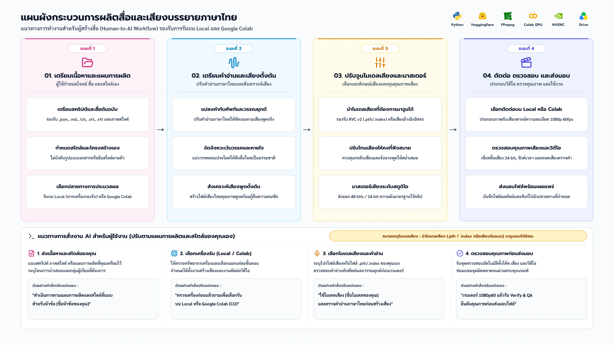
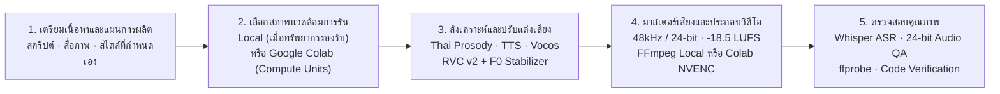

# AI Courseware & Thai Voice Studio

[](LICENSE)
[](voice-studio/pyproject.toml)
[](THIRD_PARTY_LICENSES.md)

เครื่องมือผลิตเสียงบรรยายภาษาไทยและวิดีโอการสอน (`1080p 60fps`) พร้อม AI Skills สำหรับงานผลิตและตรวจสอบคุณภาพ, คู่มือแนวทางการสั่งงาน AI (`docs/`), และโปรเจกต์ตัวอย่างตั้งต้น (`sample-project/`) โดยผู้ใช้สามารถเตรียมเนื้อหาและกำหนดสไตล์สื่อของตนเองได้อย่างอิสระ และเลือกได้ว่าจะประมวลผลการสร้างเสียงและการตัดต่อวิดีโอบนเครื่อง **Local** หรือ **Google Colab**



---

## สถาปัตยกรรมระบบ



---

## ตัวอย่างผลลัพธ์ (Sample Output Preview & Player)

ตัวอย่างภาพสไลด์ ไฟล์เสียง และวิดีโอ `1080p 60fps` ที่สร้างจริงจาก [`sample-project/`](sample-project/README.md) ด้วย `voice-studio` บน Google Colab L4:

### วิดีโอตัวอย่าง (`1080p 60fps` — คลิกเพื่อเล่น)

https://github.com/NiRUNELEM/ai-courseware-voice-studio/raw/main/sample-project/examples/sample_hybrid_rvc_web.mp4

> หากเบราว์เซอร์ไม่แสดงตัวเล่นอัตโนมัติ สามารถกดเปิดเล่นตรงในเบราว์เซอร์ได้ทันที:
> - **เล่นวิดีโอในเบราว์เซอร์ (H.264 Web Player):** [เปิดเล่นวิดีโอ 1080p60 (`sample_hybrid_rvc_web.mp4`)](https://raw.githubusercontent.com/NiRUNELEM/ai-courseware-voice-studio/main/sample-project/examples/sample_hybrid_rvc_web.mp4)
> - **เล่นเสียงบรรยายในเบราว์เซอร์ (MP3 320 kbps):** [เปิดฟังเสียงตัวอย่าง (`sample_hybrid_rvc.mp3`)](https://raw.githubusercontent.com/NiRUNELEM/ai-courseware-voice-studio/main/sample-project/examples/sample_hybrid_rvc.mp3)

| สไลด์ตัวอย่างที่ 1 | สไลด์ตัวอย่างที่ 2 | สไลด์ตัวอย่างที่ 3 |
|---|---|---|
|  |  |  |

| รายการตัวอย่าง | รูปแบบ / สเปก | ลิงก์เปิดดู / ดาวน์โหลด |
|---|---|---|
| **วิดีโอบรรยาย (Web H.264)** | `1920x1080`, `60 fps`, `H.264 + AAC`, `53.7s` | [sample_hybrid_rvc_web.mp4](

https://github.com/user-attachments/assets/bc78122e-2775-4485-a2a1-10df6acb81fa

---

## โครงสร้าง Repository

```text
ai-courseware-voice-studio/
├── README.md
├── LICENSE                                       # MIT License
├── THIRD_PARTY_LICENSES.md                       # แหล่งที่มาและสัญญาอนุญาตของโมเดลและไลบรารี
├── docs/
│   ├── PIPELINE_GUIDE_TH.md                      # คู่มือการใช้งานและการสั่งงาน AI
│   └── pipeline_architecture_th.webp             # แผนผังกระบวนการทำงาน
├── skills/                                       # AI Skills (รวมเหลือ 2 ชุด, เชื่อม Symlink ไปยัง .agents/skills/)
│   ├── README.md
│   ├── yourin-autohealing-architect/SKILL.md     # Execution, Auto-Healing & Verification
│   └── voice-studio-production/SKILL.md          # CLI/MCP/Colab Bridges, Model Discovery, Local/Colab & Thai Prosody
├── sample-project/                               # โปรเจกต์ตัวอย่างตั้งต้น
│   ├── README.md
│   ├── sample_script.json
│   ├── job_sample.yaml
│   └── app/
└── voice-studio/                                 # เครื่องมือ Voice Studio CLI
    ├── studio.py
    ├── configs/
    ├── input/
    ├── colab/
    ├── licenses/
    ├── src/
    └── tests/
```

---

## ความต้องการของระบบ (Prerequisites)

| สภาพแวดล้อม | ข้อกำหนดที่จำเป็น |
|---|---|
| **พื้นฐาน (จำเป็นทุกโหมด)** | `Python 3.11+`, `ffmpeg` & `ffprobe` (พร้อม `libsoxr`), แพ็กเกจใน `voice-studio/requirements.txt` |
| **รันบนเครื่อง Local (Direct TTS / ตัดต่อ)** | RAM `>= 4 GB`, อินเทอร์เน็ตสำหรับ `edge-tts` |
| **รันบนเครื่อง Local (OmniVoice-Thai + RVC v2)** | NVIDIA GPU CUDA (`>= 8 GB VRAM`, `sm_75+`), RAM `>= 16 GB`, พื้นที่ว่าง `>= 10 GB` |
| **รันบน Google Colab (`--target colab_cli`)** | บัญชี Google Colab (Compute Units) พร้อมติดตั้งและลงชื่อเข้าใช้ `colab-cli` |
| **Sample App (ทางเลือก)** | `Bun >= 1.3` (สำหรับรันตัวอย่างใน `sample-project/app`) |

---

## เริ่มต้นใช้งาน (Quick Start)

### 1. ติดตั้งและตรวจความพร้อมของเครื่อง

```bash
cd voice-studio
python3 -m venv .venv
.venv/bin/pip install -r requirements.txt

.venv/bin/python studio.py doctor
.venv/bin/python studio.py verify
.venv/bin/python studio.py input check ../sample-project/sample_script.json
```

### 2. ทดสอบโปรเจกต์ตัวอย่างและเลือกปลายทางการรัน

```bash
# ทดสอบโค้ดตัวอย่าง
cd ../sample-project/app
bun test

# รันบนเครื่อง Local (เมื่อทรัพยากรเครื่องรองรับ)
cd ..
../voice-studio/.venv/bin/python ../voice-studio/studio.py run \
  --config job_sample.yaml --voice direct_tts --target local

# รันบน Google Colab Pro (ใช้ Compute Units)
../voice-studio/.venv/bin/python ../voice-studio/studio.py run \
  --config job_sample.yaml --voice gawr_gura_hybrid --target colab_cli
```

### 3. การนำโมเดลเสียงของตนเองมาใช้งาน

1. คัดลอกไฟล์ [voice-studio/configs/custom_voice.example.yaml](voice-studio/configs/custom_voice.example.yaml)
2. ระบุไฟล์โมเดล RVC v2 (`.pth` และ `.index`) หรือคลิปเสียงพูดภาษาไทยความยาว `5–10` วินาทีสำหรับโคลนเสียงแบบ Zero-Shot
3. ดูรายละเอียดการตั้งค่าเพิ่มเติมใน [docs/PIPELINE_GUIDE_TH.md](docs/PIPELINE_GUIDE_TH.md)

### 4. การใช้งาน AI Skills และ MCP Server

- **AI Skills:** เปิด Repository นี้ใน AI Coding Agent ที่รองรับ `.agents/skills/` เพื่อโหลด Skill ทั้ง 2 ชุดใน [`skills/`](skills/README.md) (รองรับการค้นหาโมเดลเสียงจาก Hugging Face/GitHub, การถามเลือกโหมดสื่อสารครั้งแรก และเลือก Local หรือ Google Colab แยกขั้นสร้างเสียงและตัดต่อ)
- **MCP Server:** ตั้งค่าการเชื่อมต่อ Voice Studio MCP Server จากตัวอย่างใน [voice-studio/configs/mcp_config.example.json](voice-studio/configs/mcp_config.example.json) (`python voice-studio/studio.py mcp`) เพื่อให้ AI Agent เรียกใช้เครื่องมือ (`studio_doctor`, `studio_voices`, `studio_run`, `studio_colab_*`, `studio_transcribe`) ผ่าน MCP ได้โดยตรง

---

## สัญญาอนุญาต (License)

- ซอร์สโค้ดและเอกสารใน Repository นี้เผยแพร่ภายใต้ [MIT License](LICENSE)
- โมเดล AI และไลบรารีของบุคคลที่สามทั้งหมดไม่รวมอยู่ใน Git และอยู่ภายใต้สัญญาอนุญาตของเจ้าของผลงานต้นฉบับ โปรดดูรายละเอียดใน [THIRD_PARTY_LICENSES.md](THIRD_PARTY_LICENSES.md)
