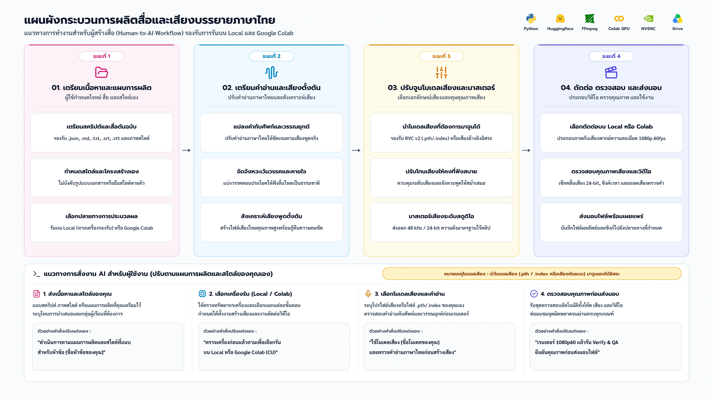

# คู่มือสถาปัตยกรรมและแนวทางการสั่งงานผลิตสื่อการสอน (Courseware + Voice Studio Pipeline)

เอกสารนี้สรุปสายการผลิตสื่อการสอนแบบอัตโนมัติครบวงจร ตั้งแต่การสอบทานเอกสารอ้างอิง การพัฒนาโค้ดต้นแบบและชุดทดสอบ การจัดทำตำรา สไลด์เวกเตอร์ แบบทดสอบ การแปลงคำอ่านภาษาไทย การนำโมเดลเสียงที่ต้องการมาปรับจูน ไปจนถึงการเรนเดอร์วิดีโอ **`1080p 60fps HEVC`** และส่งมอบขึ้น Google Drive โดยผู้นำไปประยุกต์ใช้สามารถกำหนดโจทย์ เทคโนโลยี สไตล์สไลด์ และโมเดลเสียงเองได้อย่างอิสระ

---

## ส่วนที่ 1: สรุปขั้นตอน Pipeline 7 ข้อ (ฉบับย่อสำหรับแบ่งปัน)

1. **วางโครงสร้างและสอบทานเอกสารอ้างอิงจริง** — กำหนดขอบเขตเนื้อหา วัตถุประสงค์การเรียนรู้ และตรวจสอบหนังสืออ้างอิงวิชาการจริงให้ตรงเลขหน้าก่อนเริ่มเขียน
2. **สร้างซอร์สโค้ดต้นแบบและชุดทดสอบอัตโนมัติ** — พัฒนาโปรเจกต์ใช้งานจริงและใบงานย่อย พร้อมรันตรวจ Typecheck, Unit/API Test และ Live E2E ให้ผ่านครบก่อนนำไปอธิบายในบทเรียน
3. **ผลิตเอกสารคำสอน แผนผัง และชุดข้อสอบด้วยโค้ด** — สร้างแผนภาพสถาปัตยกรรม เอกสารคำสอนแยกไฟล์ตามโครงสร้างมาตรฐาน แผนการจัดทำ และข้อสอบ Kahoot / Quizizz อัตโนมัติ
4. **สร้างสไลด์ Native Vector คมชัดสูง** — ออกแบบสไลด์อัตราส่วน `16:9` ด้วยกล่องข้อความและผังเวกเตอร์จริงทั้งหมด จัดวางเนื้อหาเด่นชัดเต็มพื้นที่โดยไร้ภาพ AI Noise และส่งออกภาพ `1920x1080`
5. **เขียนบทบรรยายเสริมความเข้าใจและแปลงคำอ่านไทยแท้** — เรียบเรียงบทพูดที่อธิบายที่มา หน้าที่ และการเชื่อมโยงของแต่ละส่วนเพิ่มเติมจากสไลด์ แล้วแปลงคำทับศัพท์และสัญลักษณ์ทั้งหมดเป็นคำอ่านภาษาไทยพร้อมจังหวะเว้นวรรคหายใจ
6. **สังเคราะห์เสียง จูนโมเดลเสียง และเรนเดอร์วิดีโอผ่าน Cloud GPU** — สร้างเสียงตั้งต้น กู้คืนฮาร์มอนิก นำโมเดลเสียงที่ต้องการ (เช่น RVC v2 `.pth` + `.index`) มาจูนพร้อม Broadcast Mastering (`48 kHz / 24-bit`, `-18.5 LUFS`), ตรวจด้วย `Whisper ASR` และเรนเดอร์วิดีโอ `1080p60 HEVC`
7. **ตรวจรับคุณภาพอัตโนมัติและส่งมอบขึ้น Google Drive** — รันระบบตรวจสอบคำผิด สระวรรณยุกต์ โครงสร้างโค้ด และคุณภาพไฟล์สื่อซ้ำครบทุกเกณฑ์ ก่อนจัดหมวดหมู่อัปโหลดขึ้น Google Drive พร้อมใช้งาน

---

## ส่วนที่ 2: สถาปัตยกรรมแยกส่วนอิสระ (Strict Standalone Separation)

ระบบออกแบบแยกโปรเจกต์ออกเป็นส่วนอิสระชัดเจน ปราศจากการผูกโค้ดข้ามโปรเจกต์ โดยสื่อสารผ่านไฟล์ตั้งค่ามาตรฐาน:

| โมดูลหลัก | หน้าที่และความรับผิดชอบ | ลักษณะการทำงาน |
|---|---|---|
| `voice-studio/` | สังเคราะห์เสียง จูนโมเดลเสียง RVC v2 ปรับแต่งเสียง Broadcast, Whisper ASR และเรนเดอร์วิดีโอ `1080p60` บน Local / Colab L4 | รองรับทั้งโมเดลเสียงสำเร็จรูปและการนำไฟล์เสียง/โมเดล `.pth` + `.index` ของผู้ใช้เองมาปรับจูน |
| ชุดผลิตสื่อการสอน | สร้างเอกสารตำราแยกหมวดหมู่ สไลด์เวกเตอร์ โค้ดต้นแบบ ใบงานปฏิบัติการ บทบรรยายคำอ่านไทยแท้ และชุดข้อสอบ | เปลี่ยนหัวข้อ ภาษาโปรแกรม เฟรมเวิร์ก และฐานข้อมูลเป้าหมายได้ตามรายวิชา |

---

## ส่วนที่ 3: รายละเอียดสายการผลิต 4 ระยะ

### ระยะที่ 1: ออกแบบตำรา สไลด์ โค้ด และคำอ่านไทยแท้
- **สอบทานแหล่งอ้างอิงและโครงสร้างบท:** ตรวจสอบเอกสารวิชาการจริงและเลขหน้าให้ตรงเนื้อหาก่อนเรียบเรียงเอกสารคำสอนแยกส่วนตามรูปแบบมาตรฐาน พร้อมรวบรวมเอกสารอ้างอิงไว้ท้ายบทอย่างเป็นระบบ
- **พัฒนาโค้ดต้นแบบและชุดทดสอบอัตโนมัติ:** สร้างใบงานย่อยและระบบตัวอย่างจริงที่เชื่อมต่อฐานข้อมูล การยืนยันตัวตน การกำหนดสิทธิ์ และการทดสอบอัตโนมัติครบทุกชั้น
- **สไลด์ Native Vector มินิมอล + ผัง Mermaid และคำอ่านไทยแท้:** สร้างสไลด์โทนสะอาดตา ไร้ AI Noise ปรับขนาด Badge อัตโนมัติ แยกสไลด์ที่ข้อมูลแออัดและแยกผัง **Mermaid** แบบมินิมอลไว้ดูเฉพาะหน้า ส่งออก `.pptx`, `.odp`, `.pdf` และภาพ `1920x1080` พร้อมแปลงสคริปต์ด้วยโหมด `phonetic_spaced` (`zero_latin_phonetic: true`) และสอบทานคำอ่านอังกฤษ-ไทยพร้อมวรรณยุกต์ด้วย **Google Translate**

### ระยะที่ 2: สังเคราะห์เสียงไทยตั้งต้นและลดความก้อง (`Stage 1` + `Stage 1.5`)
- **Stage 1 (`OmniVoice-Thai` / `Edge-TTS`):** สร้างเสียงพูดตั้งต้นโดยรองรับทั้งโมเดลเสียงไทย Zero-Shot Diffusion และ TTS ทั่วไป พร้อมเว้นจังหวะหายใจธรรมชาติ (`clause_spacing`, `pacing_sec: 0.30`)
- **Stage 1.5 (`Vocos` Mel-Resynthesis & Conditioning):** กู้คืนรายละเอียดฮาร์มอนิกระดับ `48 kHz` ลดความก้องของ Discrete Codec แล้วผ่าน Pre-RVC Headroom Conditioning (`afftdn nr=6`, `acompressor 1.5:1 (-16dB)`, `alimiter -3.5 dB`)

### ระยะที่ 3: การนำโมเดลเสียงที่ต้องการมาปรับจูนเอง (Custom Voice Model Tuning) และ Mastering
ระบบเปิดให้ผู้ใช้งานนำ **โมเดลเสียงที่ต้องการ** มาปรับจูนได้อิสระ 2 แนวทางหลัก ดังนี้:
1. **นำไฟล์โมเดล RVC v2 มาวางและตั้งค่า (`models/<voice_name>/` หรือ `custom_voice.yaml`):** ใส่ไฟล์น้ำหนักเสียง `.pth` และไฟล์ดัชนี `.index` ที่ผู้ใช้ฝึกเองหรือเลือกใช้ แล้วปรับจูนพารามิเตอร์หลักให้เหมาะกับภาษาไทย:
   - `f0_method: rmvpe` ร่วมกับ **F0 Stabilizer** (Voiced-Only 3-Frame Median + Hann Smoothing) เพื่อลดอาการเสียงสั่น (pitch warble) โดยคงวรรณยุกต์ไทยครบถ้วน
   - `pitch_shift` ปรับระดับคีย์สูง-ต่ำให้กลมกลืนระหว่างเสียงตั้งต้นกับโมเดลที่นำมาจูน
   - `index_rate` (แนะนำ `0.05`–`0.12` สำหรับภาษาไทย) คุมสัดส่วนเนื้อเสียงโมเดลไม่ให้สระแตกพร่า
   - `volume_envelope` (แนะนำ `0.75`) และ `input_gate_threshold: 0.004` ลดอาการ RMS pumping และเสียงสั่นท้ายคำ
   - `protect` (แนะนำ `0.50`–`0.60`) ปกป้องพยัญชนะไม่ก้องและตัวสะกดภาษาไทย
   - `rvc_fp32: true` และ `intermediate_float: true` ประมวลผล 32-bit float ตลอดสายเพื่อลดพื้นเสียงรบกวน
2. **นำคลิปเสียงอ้างอิงภาษาไทยแห้งใสมาโคลนแบบ Zero-Shot:** ระบุไฟล์เสียงอ้างอิงเพื่อเป็นเสียงตั้งต้นให้โมเดลพูดภาษาไทยตามจังหวะหายใจก่อนส่งต่อเข้าสู่ Broadcast Mastering
3. **Broadcast Mastering (`Stage 3`) ที่ปรับจูนได้ครบผ่าน YAML:** รองรับ `eq_preset` (`anime_female`, `warm_male`, `neutral`, `off`) หรือระบุ `eq_bands` เอง, `highpass_hz`, `lowpass_hz`, `comp_threshold_db`, `comp_ratio`, `gate_ratio`, `gate_release_ms`, `limiter_db` (ค่ามาตรฐาน `-1.8 dBFS`), `pre_rvc_conditioning`, และ `video_codec` (`auto`, `hevc`, `h264`, `libx264`, `libx265`) พร้อมส่งออก `48 kHz / 24-bit PCM` ผ่าน `libsoxr` ความแม่นยำ `33-bit` (ดูตัวอย่างใน `voice-studio/configs/custom_voice.example.yaml`)

| พารามิเตอร์ | โปรไฟล์ไทยแท้ (Zero-Shot + RVC v2) | โปรไฟล์ผสมสองภาษา (Neural TTS + RVC v2) | บทบาทในการจูนเสียงที่นำมาใช้ |
|---|---|---|---|
| `f0_method` | `rmvpe` | `rmvpe` | สกัดความถี่มูลฐานแม่นยำ รักษาวรรณยุกต์ไทยไม่เพี้ยน |
| `pitch_shift` | `0` (หรือปรับตามคีย์เสียงต้นฉบับ) | `+2` (หรือปรับตามคีย์ผู้พูด) | จับคู่ระดับเสียงผู้พูดตั้งต้นกับโมเดล RVC ที่นำมาจูน |
| `index_rate` | `0.05`–`0.10` | `0.10`–`0.20` | คุมน้ำหนักเนื้อเสียงของโมเดลที่นำมาใช้โดยไม่กัดสระไทย |
| `protect` | `0.50`–`0.60` | `0.45`–`0.55` | ป้องกันพยัญชนะท้ายคำและเสียงเสียดแทรกหายไประหว่างแปลง |
| `rvc_fp32` / Float | `True` / `True` | `True` / `True` | คงความละเอียด 32-bit float ลด quantization noise |
| Stage 3 Export | `48 kHz / 24-bit`, `-18.5 LUFS`, `SoXR-33` | `48 kHz / 24-bit`, `-18.0 LUFS`, `SoXR-33` | คุณภาพไฟล์เสียงระดับออกอากาศ ปราศจากเสียงคลิป |

### ระยะที่ 4: ตรวจรับคุณภาพ เรนเดอร์ 1080p60 และส่งมอบ Google Drive
- **Audio QA & Whisper ASR:** ตรวจ `SNR >= 45 dB`, `0 Clipping`, ความดังตามเป้า และถอดเสียงตรวจความชัดเจนภาษาไทยด้วย `Whisper Large-v3-Turbo`
- **NVENC 1080p60 Render:** ประกอบภาพสไลด์กับเสียงรายสไลด์ด้วย `hevc_nvenc` (`60 fps`, `AAC 320 kbps`) พร้อมตัวเล่น HTML แบบโต้ตอบ
- **Quality Gates & Cloud Sync:** รันตรวจคำผิดและสระวรรณยุกต์ซ้ำสองชั้น ตรวจโครงสร้างโค้ด 5 เกต (`<= 500` บรรทัด/ไฟล์, `0` clone, `0` silent catch) แล้วจัดหมวดหมู่อัปโหลดขึ้น Google Drive

---

## ส่วนที่ 4: แนวทางการสั่งงานด้วย AI Agent (ปรับแต่งตามโจทย์ของผู้ใช้เอง)

ผู้อ่านสามารถนำแนวทางนี้ไปสั่งงาน AI Agent ด้วย **ภาษาธรรมชาติของคุณเอง** โดยระบุหัวข้อ เอกสารอ้างอิง สแตกเทคโนโลยี สไตล์สไลด์ และโมเดลเสียงที่ต้องการได้ทันทีโดยไม่ต้องติดกับข้อมูลตัวอย่างเดิม:

### 1. ขั้นตอนการสื่อสารกับ AI Agent 4 ระยะ
1. **แนบบริบทและแหล่งอ้างอิงของคุณ:** ส่งโครงร่างบทเรียน แผนการสอน หรือลิงก์คลังเอกสารวิชาการของคุณ แล้วสั่งให้ AI ตรวจสอบเลขหน้าและข้อมูลจริงก่อนลงมือเขียน
2. **กำหนดเทคโนโลยีและโจทย์ระบบเอง:** ระบุภาษา เฟรมเวิร์ก ฐานข้อมูล และกรณีศึกษาที่ต้องการ พร้อมเงื่อนไขให้ AI สร้างโค้ดต้นแบบและรันชุดทดสอบอัตโนมัติให้ผ่านทั้งหมด
3. **กำกับสไตล์สไลด์และบทพูดเชิงลึก:** กำหนดโทนสีสไลด์ที่โปร่งสะอาด ไร้ AI Noise วางเนื้อหาเด่นชัด และสั่งเขียนบทบรรยายที่อธิบายหน้าที่ การเชื่อมโยง และคำอ่านไทยแท้ครบทุกหน้า
4. **เลือกโมเดลเสียงและสั่งส่งมอบคลาวด์:** ระบุโมเดลเสียงที่คุณนำมาจูนเอง (หรือโปรไฟล์ในระบบ) ให้ AI เรนเดอร์วิดีโอ `1080p60` ตรวจคำผิดซ้ำ และอัปโหลดขึ้นโฟลเดอร์ Google Drive ปลายทางของคุณ

### 2. ตัวอย่างประโยคคำสั่งปรับแต่งเอง (Generic Custom Prompt Templates)

- **ขั้นตอนที่ 1 (แนบโจทย์และแหล่งอ้างอิงของคุณ):**
  > สร้างเอกสารคำสอน สไลด์ แบบทดสอบ โค้ดตัวอย่าง และบทบรรยายเรื่อง [ระบุชื่อบทหรือหัวข้อของคุณ] โดยอ้างอิงจากเอกสารในลิงก์หรือไฟล์ที่แนบ ตรวจสอบเลขหน้าจริงและสรุปรายการอ้างอิงไว้ท้ายบท

- **ขั้นตอนที่ 2 (กำหนดเทคโนโลยีและระบบกรณีศึกษาของคุณเอง):**
  > พัฒนาโปรเจกต์ตัวอย่างและใบงานย่อยสำหรับระบบ [ระบุระบบกรณีศึกษาของคุณ] ด้วยสแตก [ระบุภาษา เฟรมเวิร์ก และฐานข้อมูล เช่น Nuxt + PostgreSQL หรือสแตกที่คุณเลือก] พร้อมชุดทดสอบอัตโนมัติจนผ่านครบทุกข้อ

- **ขั้นตอนที่ 3 (กำกับสไตล์สไลด์และบทบรรยายของคุณเอง):**
  > ออกแบบสไลด์ด้วยโทนสี [ระบุโทนสีหรือสไตล์ที่คุณชอบ] ให้สะอาดตา ไร้ AI Noise และเนื้อหาอ่านง่าย จากนั้นเขียนบทพูดอธิบายหลักการ หน้าที่ และการเชื่อมโยงของแต่ละส่วนอย่างละเอียดพร้อมแปลงคำอ่านภาษาไทยแท้

- **ขั้นตอนที่ 4 (เลือกโมเดลเสียงของคุณและส่งมอบงาน):**
  > ใช้ไฟล์โมเดลเสียง [ระบุชื่อโมเดลเสียง หรือไฟล์ .pth/.index ของคุณ] จูนเสียงพากย์ตามค่ามาตรฐาน เรนเดอร์วิดีโอ 1080p60 บน Colab ตรวจคำผิดและเกตคุณภาพซ้ำทั้งหมด แล้วอัปโหลดส่งมอบลงโฟลเดอร์ [ระบุลิงก์ Google Drive ของคุณ]
